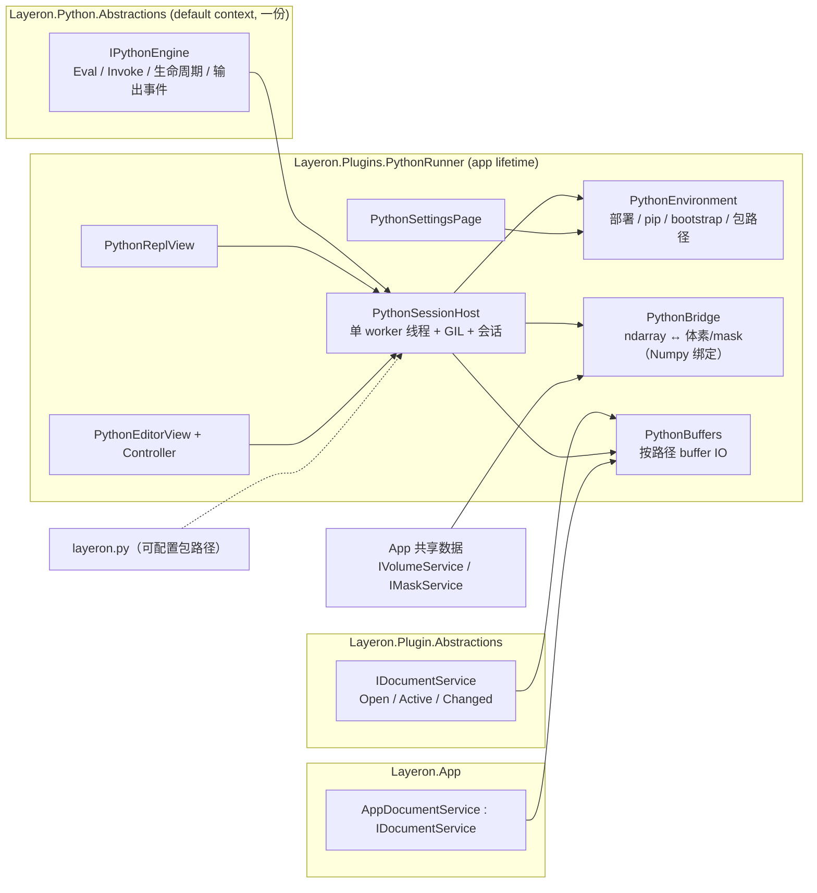

# Layeron.PythonRunner → 可用的 Python 脚本引擎：调研结论与实施计划（v2 最终）

> 本版已并入全部问答结论。

## 0.2 实施记录：P7（pip 初始化 + 安装包）已落地，含两处对计划的修正

P7 已实现：插件向宿主设置窗口贡献一页 "Python"（`PythonSettingsView.axaml(.cs)`），页面上有解释器 /
numpy / pip 状态、"初始化 pip"、"升级 pip"、包输入框、"安装"、"卸载"、"取消"、scikit-image 预设、
**已安装包列表**（`ListPackagesAsync`，取自 `pip list --format=json`），以及实时输出区（pip 输出与包列表
左右并排，装包时两者都能看）。引擎侧新增 `BootstrapPipAsync` / `UpgradePipAsync` / `RunPipAsync` /
`ListPackagesAsync` / `PipAvailable` / `NumpyAvailable` / `InterpreterAvailable`。

**pip 不再出现在启动路径上。** 之前 `EnsureReadyAsync` 里调用 `Installer.InstallPip()`，意味着"打开
REPL"会触发一次网络下载，且该调用**无超时、无取消**（实测：无网络时进程 >200s 无任何输出），失败也只
写日志。这三点都不该出现在一个只是要跑脚本的路径上，而且引擎不装 pip 也完全可用（REPL、编辑器、
numpy 都不依赖它）。现在 pip 只在用户显式点按钮时初始化。

| # | 计划 | 实测结论 | 结果 |
|---|---|---|---|
| G | §2.5"安装包：停会话 → `python -m pip install …`（带 `numpy<2` 约束）" | `--constraint` 是 pip **子命令**的选项，不是全局选项：`pip --constraint f install x` 被拒（`no such option`）；而 `pip install --constraint f x` 又无法用于 `uninstall`。另外 `--no-warn-script-location` 同样不是全局选项 | 约束改走 **`PIP_CONSTRAINT` 环境变量**（对 `install`/`uninstall`/`get-pip.py` 都生效）；全局位置只留 `--retries 2 --timeout 15`；`PIP_DISABLE_PIP_VERSION_CHECK` 也走环境变量。`--no-warn-script-location` 去掉（它只是抑制警告） |
| H | §0 决策 4 / §4 风险：约束固定 `numpy<2` | **`numpy<2` 是错的，会把环境装坏。** 部署把 numpy 解包进 `Lib`，而 `Lib` 在 `sys.path` 上排在 `Lib\site-packages` **之前**（实测 `sys.path` 顺序 + `numpy.__file__`）：`numpy<2` 允许 pip 选 numpy 1.26.4 与为它编译的 scipy 1.17.1，两者都装进 `site-packages`，但解释器仍然 import `Lib` 里的 1.23.5 → scipy 会对着错误的 ABI 加载。改为 `numpy==1.23.5` 后 pip 解析出 scikit-image 0.24.0 + scipy 1.15.3，实测 `skimage.filters.gaussian` 正常 | 约束文件写 `numpy==1.23.5`（`NumpyVersion`），语义是"pip 必须按解释器**实际导入**的 numpy 来解析"，而不是"装一个存在但用不上的 numpy" |
| I | §2.5 / §2.3：`Installer.InstallPip()` + `PythonEnvironment.cs` 负责 pip bootstrap | `Installer.InstallPip()` 同样无超时无取消。而嵌入式发行版的 `python311.zip` **不含 `ensurepip`**（实测 `ModuleNotFoundError`），所以离线路线不存在 | 自己实现 bootstrap：用带 60s 超时的 `HttpClient` 取 `get-pip.py` 存到 `Lib\get-pip.py`（可复用，二次运行不再联网），再用与 pip 相同的子进程通道执行它；结果用 `PipAvailable`（文件探针）校验。这同时让脚本能以实时输出被观察、可取消 |
| J | 沿用 `Installer.PYTHON_VERSION` 拼 `python311._pth` / `python311.zip` / `python311.dll` | **这里出过一次真实故障，记下来当反面教材。** 探针用错了 `using`（`Python.Deployment` 而非 `Python.Included`），于是把 `VersionTag` 写成 `"311"`，运行时去找 `python\311.dll` 并抛 `DllNotFoundException`。实测该字段**存在**且值为 `"python311"`（含 `python` 前缀） | 恢复使用 `Installer.PYTHON_VERSION`，不再自造版本串。教训：探针的 `using` 错会让"某字段不存在"变成一个假结论，而据此"修复"会引入真正的 bug |
| K | 设置页的忙碌保护 | **页面第一次操作后就永久拒绝后续操作。** `RunAsync` 用 `Interlocked.Exchange(ref _running, 1)` 做重入保护，但只有 `SetRunning(bool)`（它只切按钮）被调用，`_running` **从未被还原**。用户表现为"点安装/卸载什么都不发生"，状态栏停在"正在执行上一个操作…"。这是真实报告的现象，不是推测 | `finally` 里 `Interlocked.Exchange(ref _running, 0)`。教训：原子标志的置位与还原必须成对出现在同一处，靠别的方法"顺带清掉"必然漏 |
| L | §2.3 设置页内容由 `ContentFactory` 惰性创建并缓存 | **设置窗口只能打开一次。** 宿主把页面内容缓存到应用寿命，而控件同一时刻只能属于一个可视化树：第二次开窗时 `ContentPresenter` 拒绝这个已挂在他处的子控件，抛 `InvalidOperationException: already has a visual parent`，窗口布局失败。自动化验证只能发现"能打开"，必须在**第二次**打开时才暴露 | 新增 `ISettingsPageContent.Detach()`（放 `Layeron.Plugin.Abstractions`，宿主与插件都可引用），页面在 `DetachedFromVisualTree` 时自标已脱离；`SettingsWindowViewModel.NotifyWindowClosed()` 由 `SettingsWindow.Closed` 触发，页面据此把内容从旧父级摘掉。保留缓存（连同已积累的 pip 输出），不重建页面 |
| M | §2.3 `python -m pip` 子进程 + 实时输出 | **`pip list` 的 JSON 拿不到：** 现有子进程通道靠 `RedirectStandardOutput` 读管道，那是"实时输出"的实现方式，而 `ProcessStartInfo` **只能重定向到管道，不能重定向到文件** —— 要既保留实时输出又拿到可解析的 JSON，必须走 `cmd /d /s /c "… > file"`。**两个踩坑点：** ①`ArgumentList` 按 Windows argv 规则把内嵌引号转义成 `\"`，而 cmd 只认 `""` → 必须用 `StartInfo.Arguments` 整串原样传；②`pip list --format=json` 的字段名是**小写**，而 `System.Text.Json` 默认区分大小写 → 不加 `JsonPropertyName` 会静默解析成空列表（看起来像"没装任何包"而不是像 bug） | `Describe()` 返回 `(fileName, rawArguments, argumentList)`，重定向时走原样字符串；`PipListEntry` 加 `[JsonPropertyName("name"/"version")]` |

验证（不是推断）：`dotnet build` 均 0 警告 0 错误；两个测试套件全绿（`Layeron.Plugin.Test` 97/97、
`Layeron.App.Test` 25/25）。用插件生成的确切命令行实测 `install scikit-image` 成功（71s）并
`import skimage/imageio/scipy` 全部通过、`gaussian` 可运行；`uninstall` 后环境回到基线、无 `~` 残留、
`_pth` 未被改写、numpy 仍是嵌入的那一份。另用无头 Avalonia 探针加载**真实插件**并驱动页面按钮，实测：
首次开窗渲染、关闭后**再次**开窗仍渲染（偏离 L）、点"安装"把 `six` 装进列表、点"卸载"把它移除、包列表
从 pip 读到 6 项（偏离 K、M）。设计文档 §3 P7 的验收标准"实测装通 + import"已成立。**注意**：pip 是
"UI 触发的运维操作"，因此它不参与任何隐式路径——`EnsureReadyAsync` 只做部署 + numpy + 启动会话。

## 0.1 实施记录：P1–P5 已落地，与本文的三处偏离（实测得出）

P1–P5（契约 + 环境部署 + 会话/stdio 修复 + REPL + 脚本编辑器 + 菜单）已实现并验证。实现过程中有三处
必须偏离本计划，都是对真实依赖实测后得出的结论，不是取舍：

| # | 计划 | 实测结论 | 结果 |
|---|---|---|---|
| A | `pythonnet 3.0.1`（由 `Numpy` 带入） | `PythonEngine.Shutdown()` 在 .NET 10 上抛 `PlatformNotSupportedException`：它用 `BinaryFormatter` 序列化 `RuntimeData`，而该类型已被移除。开 `EnableUnsafeBinaryFormatterSerialization` 可绕过，但那要求宿主加进程级开关 | 显式引用 `pythonnet 3.2.1`；`Numpy` 的绑定在其上原样可用。**注意**：3.2.1 的 `Shutdown` 能返回，但随后 `Initialize` 抛 `NotImplementedException`（`NoopFormatter`）——所以运行时仍然只能在进程内初始化一次，计划 §2.5 的"环境重建 = 停会话 → 重装 → 重启会话"按此实现（清包+重建会话，不动 runtime） |
| B | §1.2 修复 stdio：`sys.stdout` 换成自定义 `io.TextIOBase` 子类，`write()` 回调 .NET sink | 成立，且是**唯一**可行的形态。`PythonEngine.Initialize()` 之后再 `Console.SetOut(...)` 对 Python 完全不可见（实测捕获为空）；只有从 Python 侧替换 `sys.stdout` 才生效 | 按计划实现，脚本在 `Resources/bootstrap.py`，随程序集嵌入部署 |
| C | §2.3 用独立 worker 线程 + 队列承载所有 Py 调用 | 不必要。GIL 本身已把进入解释器的线程串行化，worker 只是在 GIL 之上再加一层串行；而"可中断性"实测为零（见 D） | 改为 `SemaphoreSlim` 串行 + 线程池执行（`Task.Run` 语义），少一个线程、少一份队列状态，行为等价 |
| D | §0 决策 6：协作式取消 + best-effort `KeyboardInterrupt` | `PythonEngine.Interrupt(0)` 返回 **0（失败）**，`while True: pass` 的循环继续执行；且从主线程调用 `Interrupt` 后若再去 `Join()` worker 会**死锁调用者**（实测：进程 180s 无输出）。`KeyboardInterrupt` 注入在纯 CPU 循环上完全无效 | 保留协作式取消（`layeron.check_cancelled()`）+ best-effort `Interrupt`，但**不**阻塞等待：`InterruptAsync` 用有界等待并如实返回"没停下来"，由"重置会话"兜底。文档明示该限制 |
| E | §0 决策 1：新增 `Layeron.Python.Abstractions` 共享程序集 | P1–P5 内没有任何跨插件消费者（设计里的消费者是 P6 的 `layeron.volume` 与 P8 的 `IDocumentService`），为一个零消费者建程序集 + 加 `SharedPrefixes` + 改 slnx，属于为将来付现在的复杂度 | 暂不建独立程序集：引擎与视图同处插件内，契约（`PythonOutput`/`PythonRun`）先作为插件内部类型。等 P6/P8 真正出现第二个消费者时再抽 |
| F | §1.5 / §2.6：`Workspace.PythonScriptsDirectory`、`IScriptHostService` 复用 | 这两个文件夹名/后缀是**插件的文件约定**，而 `Layeron.Scripting.Abstractions` 与 `Layeron.App` 属于宿主侧——把 `"python"`/`".py"` 放进去等于让宿主知道插件的布局，每加一门脚本语言都要改宿主 | 宿主侧只保留真正属于宿主的能力：文件对话框（标题/目录/通配符由插件传入）、`WorkspaceRoot`、`LogRunFailure`、插件重扫。`scripts`/`.csx`/`python`/`.py` 分别归 `ScriptHost` 与 `PythonRunner` 插件自己的 `*Paths` 类型；`Workspace.EnsureCreated()` 只建根目录，子目录由各插件首次保存时创建 |

## 0. 最终决策表

| # | 主题 | 结论 |
|---|---|---|
| 1 | API 契约位置 | ~~新增共享程序集 `Layeron.Python.Abstractions`~~ → 见 §0.1 E：暂缓，先留在插件内 |
| 2 | buffer 寻址 | **按路径**。读时若编辑器持有该路径 → 读内存 buffer；否则读磁盘。写同理。不做 UI 焦点概念 |
| 3 | 活跃文档信息 | `Layeron.Plugin.Abstractions` 新增通用 `IDocumentService`（Open/Active + Changed），宿主 `Layeron.App` 实现 |
| 4 | pip 包目录 | 保持全局（嵌入解释器 `Lib\site-packages`），符合科研用户习惯；包搜索路径**可配置** |
| 5 | 安装包与会话 | 点"安装包"自动：停会话 → pip install → 重启会话，输出全程可见 |
| 6 | 执行边界 | 协作式取消（`Cancellation`）+ best-effort `KeyboardInterrupt`；纯 CPU 死循环杀不掉，"重启会话"兜底 |
| 7 | REPL 界面 | 终端风格：输入与输出同一文本框，上下键翻历史 |
| 8 | scikit-image | 不给特权路径；作为"平台可用性"测试目标，做成设置页/API 的一键预设，需实测装通 + import |
| 9 | 引擎实例位置 | 留在 PythonRunner 插件内；插件声明"随应用生命周期 / 不支持热更新"（该声明能力以后在插件管理器单独做） |
| 10 | Python 侧 API 形态 | 注入真实 `layeron.py`（放在可配置包搜索路径），函数体转发到唯一 CLR 调用面；**其他插件的 `.py` 同样可 `import layeron`** |
| 11 | Python 脚本是否成为插件 | **否**。只做 REPL + 脚本编辑/运行，不支持"把 `.py` 装成插件"（以后再说） |
| 12 | 运行命名空间 | **共享 `__main__`**：REPL 与脚本互通；重置会话是唯一清理手段 |
| 13 | 读体数据的语义 | `layeron.volume` 给**零拷贝只读 numpy 视图**（[z,y,x]），写入走 `set_volume`/`mask_add`；`read_roi` / `read_xy_slice` / `histogram` 等 C 侧本就是复制语义，返回 ndarray。零拷贝视图与复制路径两者都给 |
| 14 | 输出通道 | REPL 输出只到 `IPluginLog`（图像渲染以后做成独立插件） |
| 15 | matplotlib | 不做显示后端。`plt.show()` 空转（非交互后端），用户自己 `savefig` |
| 16 | Python 脚本目录 | 工作区下另开 `python/` 子目录，与 C# 的 `scripts/` 分开 |
| 17 | 跨插件面 | **只做"类外部进程"级交互**：`EvalAsync` / `InvokeAsync(qualifiedName, jsonArgs) -> json` / stdout 事件流。**不传大体素/mask** —— 这类共享走 App 自己的 `IVolumeService`/`IMaskService` |
| 18 | numpy 来源 | 保留 `Numpy(3.11.1.35)` 包与 `Numpy.dll`——**它是我们自己的互操作层要用的**（ndarray ↔ 体素/mask）。跨插件面不经过它 |
| 19 | buffer 写策略 | `WriteAsync(path, text)` 对**已打开**的文件：写内存 buffer 并标记 **dirty（未保存）**；由编辑器自己或 `save(path)` 落盘。未打开的文件才直接写盘 |
| 20 | 跨会话持久态 | 不做"pending posts / keys"式持久变量。只保留 REPL 历史 + 显式打开的 buffer，运行期内存，**不做持久化** |
| 21 | 设置页接入 | 完全走既有插件路径：`Registry.AddSettingsPage(new SettingsPageContribution { … ContentFactory = … })`，与 Threshold/ScriptHost 同样方式。**不改 App 侧**，不做"菜单跳到某设置页"，也不动既有插件设置页 |

---

## 1. 现状调研

### 1.1 PythonRunner 现状
- `Layeron.Plugins.PythonRunner/PythonRunnerPlugin.cs` 是 **demo**：`Activate` 起后台任务 → `Installer.SetupPython` → 修 `python311._pth`/`Lib`/`DLLs`/`Lib\site-packages` → `PythonEngine.Initialize` + `BeginAllowThreads` → `InstallPip` → 从 `Numpy` 内嵌 wheel 部署 numpy 1.23.5 进 `Lib` → pip 装 `isOdd` → 跑两段 demo。**无 UI、无引擎对象、无对外 API**。
- 实际包：`Python.Included 3.11.1`、`Python.Deployment 2.0.0`、`pythonnet 3.0.1`、`Numpy 3.11.1.35`（csproj 里 `pythonnet`/`Python.Included` 的显式引用被注释；注释中的版本号已过期）。
- 已部署解释器：`Layeron.App\bin\Debug\net10.0\plugins.dev\layeron.pythonrunner\python\`（`python.exe`、`python311._pth`、`Lib`（numpy 1.23.5 + `get-pip.py`）、`Lib\site-packages`（pip / setuptools / wheel / packaging / isOdd）、`Scripts\pip.exe`）。`_pth` 有一行多余的 `./Lib`（`InstallWheel` 追加，无害，重置逻辑要容忍）。

### 1.2 stdio 被"吞掉"的根因（决定修复方案）
pythonnet 的托管 I/O 是**反向接线**：runtime 初始化时把 `sys.stdout`/`sys.stderr` 设为自己创建的非托管包装对象，其 `write` 转发到 `System.Console.Out`；**只有 `sys.stdout` 为 null 时才 fallback 到"当时的" `Console.Out`**。于是：
1. runtime 初始化后 `sys.stdout` 已非 null，宿主再 `Console.SetOut(...)` **Python 看不见** → numpy/pip 输出消失；
2. 默认 wrapper 不缓存，GUI 进程（WinExe）无有效 stdout 句柄 → `print` 写进黑洞，这就是观感上的"吞掉 stdio"。

**修复**：每次 `PythonEngine.Initialize()`（含 Reset 后）紧接着执行内嵌 `bootstrap.py`，把 `sys.stdout`/`sys.stderr` 换成自定义 `io.TextIOBase` 子类，`write()` 回调 .NET sink：
- 行 → ①`IPluginLog`（`python` 上下文）②REPL 输出（广播事件）③设置页安装输出区（安装时用）。
- 同时设 `sys.displayhook`（表达式回显 `repr`）、`sys.ps1/ps2`、`sys.path`。
- pip 输出同样走 `sys.stdout` → 一并保留；`RunString/Eval` 返回值仍照常返回，互不冲突。
- 具体实现形态（Python 类 vs C# 实现 write 协议）在 P0 实测后定，对外行为一致。

### 1.3 宿主侧关键约束
- `PluginLoadContext.SharedPrefixes` 现有：`System.`、`Microsoft.Extensions.`、`Layeron.Big3DArray`、`Layeron.Plugin.Abstractions`、`Layeron.Plugin.Host`、`Layeron.Scripting.Abstractions`、`NumSharp`、Avalonia/Dock/ReactiveUI/… → 只需 **加** `Layeron.Python.Abstractions`；`Python.Runtime` 保持插件私有。
- `pythonnet 3.0.1` 公共面（反射核实）：`PythonEngine.IsInitialized/ProgramName/PythonHome/PythonPath/InteropConfiguration/Initialize(IEnumerable<string>,bool,bool)/InitExt/Shutdown/BeginAllowThreads/Eval(string,PyDict,PyObject)/Exec(同)/RunString(同)/Interrupt(ulong)/AddShutdownHandler`；`Runtime` 只剩 `PythonDLL/MainManagedThreadId/None/Py_Main`（**没有** `Runtime.PySys_*`，须 `PyObject` 或 `import sys`）。
- `Python.Deployment.Installer`：`InstallPath/Source/EmbeddedPythonHome/SetupPython(force)/InstallPip()/TryInstallPip()/IsPythonInstalled()/IsPipInstalled()/IsModuleInstalled()/PipInstallModule(module,version,force)/InstallWheel/PipInstallWheel/RunCommand`。二进制内含 `RedirectStandardOutput/Error` 但**无对外事件** → pip 实时输出要**自己起 `Scripts\pip.exe`** 并读其 stdout/stderr。
- 既有坑（原注释已记录，全部沿用）：`_pth` 必须以换行结尾；`Lib\site-packages` 必须在解释器启动**前**存在；`InstallPip`/`PipInstallModule` 只记日志不抛 → 必须事后校验；`InstallWheel` 解包进 `Lib` 而 `IsModuleInstalled` 只看 `site-packages` → numpy 用 import 校验；已 import 的原生 `.pyd` 无法被 pip 替换，会留 `~` 目录 → 安装前停会话（决策 5）。
- numpy 是 **cp311** wheel（`Installer.PYTHON_VERSION == "311"`）→ 装 scikit-image 等须约束 `numpy<2`，否则 ABI 崩。

### 1.4 可复用基础设施
`SettingsPageContribution.ContentFactory`、`DockableIds.ForPluginDocument`、`IPluginRegistry.AddDocument/AddMenu`、`IDockableContribution.Open()`、`AppScriptHostService`（脚本目录 + 文件对话框 + 重扫）、`DeploySamplePlugins`（自动把 plugin 输出拷进 `plugins.dev\layeron.pythonrunner`）、`MaskColor`/`Big3DBitMap`/`Big3DArrayFactory`/`VolumeIO`（64³ 块，`GetBlockSpan`/`ReadRoi`/`GetXYSlice`）、`VolumeHistogram`。

### 1.5 可复制的范式：ScriptHost
| 关注点 | C# ScriptHost | Python 侧 |
|---|---|---|
| 插件入口 | `ScriptHostPlugin.Activate`：source + 编辑器 controller + 菜单 | REPL/编辑器 document + 菜单 + 设置页（**无** source，决策 11） |
| 多文档 | `ScriptEditorController`：一个脚本一个 `DocumentContribution`，句柄去重，`Forget(view)` 回收 | 同构 `PythonDocumentController` |
| 编辑器 | `ScriptEditorView`：AvaloniaEdit + 工具栏 + 状态行 + 进度条 | 复刻（Python 高亮） |
| 运行 | `Task.Run` + `ScriptRunContext`(Cancellation/Status/Progress/Invoke) | 改为"单 worker 线程 + 队列"，语义相同 |
| 宿主 seam | `IScriptHostService` | 复用同一 seam（对话框/目录），目录换为 `python/` |

### 1.6 要移植的"计算子集"（源：`ScriptGlobals`）
保留：`Volume`、`VolumeVersion`、`Snapshot()`、`Crosshair`、`Histogram()`、`ReadRoi`、`ReadXYSlice`、`Cancellation`、`Status`、`Progress`、`Result`、`Log`、`AddMask`、`ReplaceVolume`、`Preview`。
剔除：`Menu`、`Tool`、`Contribute`、`Plugin` 及一切插件能力。

---

## 2. 目标架构



### 2.1 `Layeron.Python.Abstractions`（新，仅"外部进程级"交互）
```csharp
public enum PythonState { NotStarted, Deploying, Ready, Installing, Busy, Faulted }

public sealed record PythonOutput(string Stream, string Text);          // stdout / stderr
public sealed record PythonResult(bool Ok, string Output, string? Value, string? Error, double ElapsedMs);

public interface IPythonEngine
{
    // 生命周期
    PythonState State { get; }
    string? Version { get; }  string? Home { get; }
    IReadOnlyList<string> PackagePaths { get; set; }        // 可配置的包搜索路径
    Task EnsureReadyAsync(CancellationToken ct = default);
    Task ResetSessionAsync(CancellationToken ct = default);
    Task RebuildEnvironmentAsync(IProgress<PythonOutput>? progress = null, CancellationToken ct = default);

    // 执行（类外部进程）
    Task<PythonResult> EvalAsync(string code, string? bufferPath = null, CancellationToken ct = default);
    Task<string?> InvokeAsync(string qualifiedName, string jsonArgs, CancellationToken ct = default);

    // 包
    Task<bool> InstallPackagesAsync(IEnumerable<string> specs, IProgress<PythonOutput>? progress = null, CancellationToken ct = default);
    bool IsModuleAvailable(string module);

    // 流
    event Action<PythonOutput>? Output;
    event Action<PythonState>? StateChanged;
}

public interface IPythonDocuments        // 决策 2：按路径寻址
{
    IReadOnlyList<PythonBufferInfo> Buffers { get; }         // REPL + 打开的 .py
    Task<string> ReadAsync(string path, CancellationToken ct = default);       // 内存 buffer 优先，磁盘兜底
    Task WriteAsync(string path, string text, CancellationToken ct = default); // 已打开→改 buffer；未打开→写盘
    Task<bool> RunAsync(string path, CancellationToken ct = default);
    Task SaveAsync(string path, CancellationToken ct = default);
    Task<bool> OpenInEditorAsync(string path, CancellationToken ct = default);
    string? ToLocalPath(string pathOrUri);                   // file:// / 相对 / 绝对 均可
}
public sealed record PythonBufferInfo(string Id, string Title, string? Path, bool IsDirty, bool IsRepl);
```
> **不**跨插件传体素/mask：大体数据走 App 的 `IVolumeService`/`IMaskService`（决策 17）。

### 2.2 `IDocumentService`（放 `Layeron.Plugin.Abstractions`，决策 3）
```csharp
public sealed record DocumentInfo(string Id, string Title, string TypeId, string? Path, bool IsDirty, bool IsActive);
public interface IDocumentService
{
    IReadOnlyList<DocumentInfo> Documents { get; }
    DocumentInfo? Active { get; }
    event Action? Changed;
    bool Activate(string id);
    bool Open(string pathOrTypeId, string? title = null);
    bool Close(string id);
}
```

### 2.3 插件内部模块
| 文件 | 职责 |
|---|---|
| `PythonSessionHost.cs` | 专属后台线程 + `SemaphoreSlim(1)` 队列；持 `Py.GIL()`；`EnsureReady/Reset/Eval/Invoke`；异常规范化；快照版本戳 |
| `PythonEnvironment.cs` | 部署（`SetupPython` + `_pth` 修复）、pip bootstrap、`python -m pip` 子进程（实时输出）、`site-packages` 校验、包路径配置、`layeron.py` 落盘 |
| `PythonBridge.cs` | `Numpy` 绑定：体素/mask ↔ `ndarray`；只读零拷贝视图（[z,y,x]）+ 复制型 ROI/切片；`set_volume`/`mask_add` 的读取与校验 |
| `PythonBuffers.cs` | 实现 `IPythonDocuments`（内存优先、磁盘兜底；保存走编辑器） |
| `layeron.py` | 嵌入资源，落盘到包路径；函数体转发到唯一 CLR 调用面 |
| `PythonReplView.axaml(.cs)` | 终端风格 REPL：同一文本框输入输出、`>>>`/`...` 续行（`codeop.compile_command`）、上下键历史、清空、重置会话、中断 |
| `PythonEditorView.axaml(.cs)` | 复刻 ScriptHost 编辑器（Python 高亮） |
| `PythonDocumentController.cs` | 一个 `.py` 一个 document、句柄去重、`Forget(view)` |
| `PythonSettingsPage.axaml(.cs)` | 解释器/pip/numpy/scikit-image 状态、初始化 pip、安装包（文本框 + scikit-image 预设）、升级 pip、重置会话、包路径编辑、实时输出区 |
| `PythonRunnerPlugin.cs` | 精简 wiring：document/菜单/设置页；去掉 demo |

### 2.4 Python 侧 API（`import layeron`）
```python
layeron.version / engine_version
layeron.volume                      # 零拷贝只读视图，形状 [z,y,x]，dtype 随体素类型
layeron.volume_info()               # shape/dtype/version/元素类型
layeron.read_roi(x0,y0,z0,sx,sy,sz) # -> ndarray[z,y,x]（复制语义）
layeron.read_xy_slice(z)            # -> ndarray[y,x]（复制语义）
layeron.histogram()                 # -> ndarray[int64]
layeron.crosshair                   # -> (x, y, z)
layeron.set_volume(ndarray)         # 原子替换（dtype 决定 byte/ushort）
layeron.masks                       # 现有 mask 元信息列表
layeron.mask_add(name, ndarray_bool, color=None)   # -> 图层信息
layeron.status(msg) / progress(f) / result(label, value) / log(msg)
layeron.check_cancelled()
layeron.call(qualified_name, *args) # 转发到 IpythonEngine.Invoke
```
- 体素/mask 一律 `numpy.ndarray`（`uint8`/`uint16`/`bool`）。
- `layeron.volume` 是**只读视图**：写入必须走 `set_volume` / `mask_add`（决策 13）。
- 版本戳语义与 `VolumeSnapshot` 一致：过期只告警，不阻塞。

### 2.5 会话与生命周期
- 引擎线程：所有 Py API 收敛到这一条线程（含 Reset/安装后的重启）。
- **Reset（会话重置）**：清 `__main__` globals → 重跑 `bootstrap.py` → 重设 `sys.path`/stdio/displayhook/ps1。轻量、常用。
- **环境重建（重按钮）**：停会话 → 清 `Lib\site-packages`（保留 pip 引导能力）→ 重装 pip → 重装 numpy → 重启会话。
- **安装包**：停会话 → `python -m pip install …`（带 `numpy<2` 约束；输出实时进设置页）→ 重启会话。
- PythonRunner 声明"随应用生命周期"；`Shutdown` 只在应用退出时做。

### 2.6 菜单与文档
- 菜单 `插件 → Python`：`新建 Python 脚本`、`打开…`、`REPL`、`重置会话`。（**无**"重新加载脚本"——决策 11；**无**"Python 设置…"跳转——设置页在设置窗口里自行找到，见决策 21）
- 文档：REPL 固定 `python:repl`；每个 `.py` 为 `python:<文件名>`；激活时预注册 `${Workspace}/python/*.py`。
- `IScriptHostService` 的文件对话框复用于 `.py`；工作区新增 `python/` 子目录（`Workspace.PythonScriptsDirectory`）。

---

## 3. 分阶段实施
| 阶段 | 内容 | 验证 |
|---|---|---|
| P0 | 实测探针：`Exec` 重载签名、`Shutdown→Initialize` 可重复性、自定义 stdout 实现形态、pip 子进程实时输出 | 临时探针，不改产品代码 |
| P1 | `Layeron.Python.Abstractions` + `SharedPrefixes` 加项 + `IDocumentService` 契约 + `Workspace.PythonScriptsDirectory` | 编译/现有测试不回归 |
| P2 | `PythonEnvironment`（部署/`_pth`/pip 子进程/包路径/`layeron.py` 落盘）+ 实测装通 `scikit-image` | 手工 + 脚本化验证 |
| P3 | `PythonSessionHost` + stdio 修复 + bootstrap（`layeron` 模块、displayhook、ps1/ps2、sys.path） | REPL 中 `print`、`1+1`、pip 输出均可见 |
| P4 | REPL 界面（终端风格、续行、历史、清空/重置/中断） | 手工冒烟 |
| P5 | 脚本编辑器 + 控制器 + 菜单 | 手工冒烟 |
| P6 | `PythonBridge`（numpy 往返 + 零拷贝视图）+ `layeron` 完整 API + `PythonBuffers` | 单元测试：体素/mask 往返、buffer 内存/磁盘语义 |
| P7 | 设置页 + `InstallPackagesAsync` + scikit-image 预设 | ✅ 实测装通 `scikit-image` 并 import 成功（见 §0.2） |
| P8 | `AppDocumentService` + `AppPluginServices` 服务表泛化 | 单测：文档列表/Active/Open |
| P9 | 文档：`docs/{,en/}guide/python.md`、`api-reference` 增补、`EXTENSION_ARCHITECTURE.md` §6 更新 | —— |
| P10 | 集成测试（解释器缺席时 Skip）+ 清理 demo | `dotnet test` |

---

## 4. 风险
| 风险 | 对策 |
|---|---|
| `site-packages` 已有 pip/setuptools/numpy，重置别删必需件 | 两级：会话重置（安全常用）/ 环境重建（显式按钮，重装 pip+numpy） |
| numpy 1.23.5 (cp311) 与 pip 装的包 ABI | 安装命令固定 `numpy==1.23.5`（**不是** `numpy<2`：见 §0.2 偏离 H，`Lib` 在 `site-packages` 之前，`<2` 会让 pip 解析出一份用不上的 numpy）；numpy 本身仍用 `Numpy` 内嵌 wheel |
| 嵌入解释器 `_pth` 隔离使 `sys.path` 不含用户包目录 | bootstrap 显式 `sys.path` 注入配置目录；`import site` 保留 |
| PythonRunner 无法卸载（pythonnet 进程级） | 声明"随应用生命周期"；文档写明 |
| `KeyboardInterrupt` 注入不可靠 | 文档明示；"重启会话"兜底 |
| 跨 ALC 传活对象 | 只传契约接口 + 文本/JSON；大体数据走 App 服务 |
| REPL 与脚本共用 `__main__` 的命名冲突 | 顺其自然（已确认不隔离）；REPL 提供 `dir()`/globals 计数；重置是唯一清理手段 |
| 零拷贝视图在 volume 被替换后失效 | 视图绑定版本戳；`set_volume` 后旧视图标记失效，访问时给出明确异常 |
